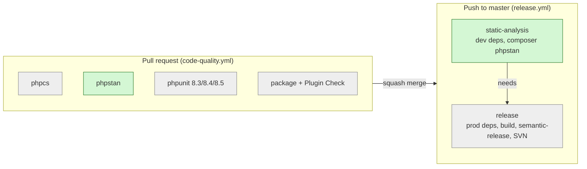

# PHPStan static analysis in the validation gate and release workflow

## 📝 TLDR

Contributors and the agent pipeline catch type mistakes only through PHPCS (style) and PHPUnit (the paths the unit tests exercise). This change would add PHPStan at **level 6** as a fourth gate step (`composer phpstan`), run it on every PR in `code-quality.yml`, and make `release.yml` refuse to cut a release when it fails. A probe of the current `master` (8ede0de) shows it is reachable with **no baseline**: one config file plus 8 docblock fixes, and no runtime behavior changes.

## 📝 Problem Statement

- **Type errors reach `master` unless a test happens to hit them.** PHPCS checks style and PHP-version compatibility, not types. PHPUnit covers only the paths the tests call. Hook callbacks, which take WooCommerce's arrays and objects, are where an unchecked `null` or a wrong array shape would get through.
- **The release is not gated by any quality check.** `master` has no branch protection (`GET …/branches/master/protection` → 404, checked 2026-10-13). `release.yml` runs on every push to `master` and only validates the package build. A PR merged with a red `code-quality.yml` would still be released to the GitHub release ZIP and, once the SVN secrets exist, to WordPress.org.
- **Evidence from the code today.** Running PHPStan 2.3.1 with `szepeviktor/phpstan-wordpress` 2.0.4 and `php-stubs/woocommerce-stubs` 11.2.0 against `src/`, the main file and `uninstall.php` produced these counts (scratch copy, no config tuning):

  | Level | 0 | 1–3 | 4–5 | 6–7 | 8 | 9 | 10 |
  |---|---|---|---|---|---|---|---|
  | Findings | 0 | 2 | 6 | 14 | 18 | 22 | 30 |

  The 2 level-1 findings are the two uses of `SHIFT64_PHONE_VALIDATION_URL` in `Assets.php:60,71`, which the analysis bootstrap resolves. None of the level-6 findings is a runtime bug (see Architecture). This is a guardrail for future changes, not a fix for present defects.

## 📝 Proposed Solution

Add PHPStan as a Composer dev dependency with the WordPress extension and WooCommerce stubs. Commit a `phpstan.neon.dist` at level 6. Wire `composer phpstan` into:

1. **The validation gate:** `.ai/agentic.config.json` `validation.commands`, `AGENTS.md`, and `SDLC.md`, after `composer phpcs` and before `composer test`.
2. **PR CI:** a `phpstan` job in `code-quality.yml`.
3. **The release:** a `static-analysis` job in `release.yml` that the `release` job `needs`, so a failure stops semantic-release before it tags anything.

   **Why only PHPStan gates the release:** the brief asks for PHPStan in the release workflow, and nothing more. The job is named `static-analysis`, not `phpstan`, so a later change can add `composer phpcs` and `composer test` to it without renaming it. Until then, PHPCS and PHPUnit stay advisory on `master`, as they are today (see Phasing).

**Alternatives considered:**

| Option | Why not chosen |
|---|---|
| Psalm | Same class of tool. PHPStan has the maintained WordPress extension (`szepeviktor/phpstan-wordpress`, which knows `apply_filters` and hook types) and the stubs the WordPress ecosystem standardises on. |
| Level 8+ now | Needs 4 more source changes (nullable narrowing around `ValidationResult::get_phone_number()`) plus the level-6 work. That is deferred so the first PR stays docblock-only (see Phasing). |
| Level 5 with no source edits | Reachable with config alone, but drops the missing-iterable-type check (level 6). That check is the one most relevant to hook callbacks taking WooCommerce arrays, and the 8 fixes are docblock-only. |
| Baseline file | Not needed. Zero errors is reachable at level 6. A baseline would hide future regressions in the same lines. |
| Running the analysis inside the existing `release` job | That job installs **production** dependencies and builds the package from that `vendor/`; `build-package.sh` refuses a dev `vendor/`. Installing PHPStan there would break the build. A separate job keeps the two installs apart. |
| Turning on branch protection only | It is a repository setting, not code. It is recommended to the maintainer below, but it does not replace the in-repo release gate: it can be switched off, and it does not cover direct pushes by admins. |

## 📝 Architecture



*Takeaway: PHPStan runs twice, once advisory-per-PR and once as a hard gate before any tag. Neither run touches the production `vendor/` the package is built from.*

**Files touched (all non-runtime unless noted):**

| File | Change |
|---|---|
| `composer.json` / `composer.lock` | require-dev: `phpstan/phpstan` `^2.1`, `szepeviktor/phpstan-wordpress` `^2.0`, `php-stubs/woocommerce-stubs` (latest), `phpstan/extension-installer` `^1.4`. `config.allow-plugins.phpstan/extension-installer: true`, because the probe showed Composer refuses the plugin without it. Script `"phpstan": "phpstan analyse --memory-limit=1G"`. |
| `phpstan.neon.dist` (new) | Config below. Already excluded from the package by `*.dist` in `.distignore`. |
| `tests/phpstan/bootstrap.php` (new) | Defines the plugin's runtime constants for analysis only. The probe showed `SHIFT64_PHONE_VALIDATION_URL` is reported "not found" in `Assets.php` even with the main file in `paths`. Under `/tests`, so it never ships. |
| `src/Admin/Settings.php`, `src/Checkout/BillingPhoneValidator.php`, `src/Checkout/ShippingPhoneValidator.php` | **Docblock-only:** 8 `@param` / `@return` array types gain value types (e.g. `array<string, mixed>`). No signature or runtime change. |
| `.github/workflows/code-quality.yml` | New `phpstan` job: PHP 8.3, Composer cache, `composer phpstan -- --error-format=github` for inline annotations. |
| `.github/workflows/release.yml` | New `static-analysis` job (dev install, `composer phpstan`). `release` gets `needs: static-analysis`. |
| `.ai/agentic.config.json`, `AGENTS.md`, `SDLC.md`, `docs/CI-CD-SETUP.md` | Gate order becomes install → phpcs → **phpstan** → test. AGENTS.md also gets a Tests-row note on how to fix PHPStan findings (below). |
| `.distignore`, `.gitignore` | `.distignore` gets explicit `/phpstan.neon` and `/phpstan-baseline.neon` entries, so a local override or a future baseline can never ship. `.gitignore` gets `phpstan.neon`, the local override convention. |

**`phpstan.neon.dist`:**

```neon
parameters:
	level: 6
	phpVersion: 80300            # the plugin's minimum, matching PHPCS testVersion 8.3-
	paths:
		- src
		- shift64-phone-validation.php
		- uninstall.php
	scanFiles:
		- vendor/php-stubs/woocommerce-stubs/woocommerce-stubs.php
		- vendor/php-stubs/woocommerce-stubs/woocommerce-packages-stubs.php
	bootstrapFiles:
		- tests/phpstan/bootstrap.php
	# The stubs pin WC_VERSION to the stub version, which makes the version_compare()
	# in BlockCheckoutValidator::init() look always-false.
	dynamicConstantNames:
		- WC_VERSION
	# Hook callbacks receive whatever other plugins pass through filters; docblock types
	# describe the expected value, not a guarantee. Keeps the defensive guards
	# (instanceof WP_REST_Request, is_string on apply_filters) from being reported as dead code.
	treatPhpDocTypesAsCertain: false
```

**What the two non-default settings fix (verified with the probe):**

- `treatPhpDocTypesAsCertain: false` removes 3 findings:
  - `BlockCheckoutValidator.php:92` and `WhitespaceFilter.php:92`: `instanceof WP_REST_Request` "always true".
  - `ErrorMessages.php:144`: `is_string` on a filtered value "always true".

  These guards are deliberate. A third-party filter can pass anything, and removing the guards to satisfy PHPStan would weaken the plugin.
- `dynamicConstantNames: [WC_VERSION]` removes `BlockCheckoutValidator.php:70`, "right side of && is always false".

With these settings, level 5 reports 0 and level 6 reports exactly 8, all `missingType.iterableValue`.

**Fixing rule, added to `AGENTS.md`:** fix a finding in the code or the docblock. Use an inline `@phpstan-ignore <identifier>` with a reason only when the code is right and PHPStan can't see why. Never weaken a runtime guard to silence a finding.

## 📝 Edge Cases & Failure Scenarios

| Scenario | What happens | Mitigation |
|---|---|---|
| A new PHPStan or stubs release reports new errors | Nothing changes until someone runs `composer update`; `composer.lock` pins the versions CI uses. | Update in a dedicated PR, where the gate shows the new findings. |
| PHPStan fails on `master` after merge | `static-analysis` fails, `release` is skipped, and no tag, ZIP or SVN deploy happens. The commits are not lost: the next green push releases every commit since the last tag (the same behavior as today's `concurrency` note). | Fix forward with a `fix:` PR. To release urgently, revert the `needs:` line (a one-line rollback). |
| A false positive from the WooCommerce stubs (stubs describe the latest WooCommerce, the plugin supports 7.2+) | The PR is blocked. | Use an inline `@phpstan-ignore` with a reason. If one pattern repeats, add an `ignoreErrors` entry with a `path` and an identifier, never a broad message regex. |
| Out-of-memory on larger runners or locally | The run crashes. | The `--memory-limit=1G` in the script. The probe needed far less: about 2.3 s of wall time on `src/`. |
| A contributor without dev dependencies | `composer phpstan` reports "command not found". | Same as `phpcs` today; the gate's `composer install` step covers it. |
| The local `phpstan.neon` override is committed by accident | It would ship in the ZIP. | `.gitignore` plus the explicit `.distignore` entry. `build-package.sh` would not catch a `.neon` file on its own. |

## 📝 Risks & Impact Review

- **Plugin users: no impact.** No runtime file changes behavior. Docblocks are not a `BACKWARD_COMPATIBILITY.md` surface: the filters, options and order meta are untouched. The shipped `composer.json` gains `require-dev` entries, which Composer ignores for a production install. Plugin Check already accepts a `composer.json` next to `vendor/`.
- **Release pipeline: a new failure mode, easy to reverse.** A red PHPStan run now holds back a release. Rollback is removing `needs: static-analysis`, or the job.
- **Contributors and agents.** The gate gains a step, about 3 s locally on this codebase. Agent skills read `validation.commands` from config, so they pick it up without skill changes.
- **The PR title decides the release.** The implementation PR should be titled `ci: …`, which cuts no release (`AGENTS.md` CI row). There is nothing for users to receive.
- **Maintainer action, outside this change.** Enable branch protection on `master` and require `PHPCS`, `PHPStan`, `PHPUnit (PHP 8.3)` and `Package + Plugin Check`. That turns the per-PR jobs from advisory into merge gates. It is a repository setting, so it is recommended here, not implemented.
- **Product brief:** no Non-goal, Business rule or Decision (D01–D08) is touched.

## 📋 Phasing

- **Phase 1 (this spec):** PHPStan at level 6 with zero baseline, in the local gate, PR CI and the release gate. One PR.
- **Later, not in scope:** each of these would need its own spec or issue if wanted.
  - Raise to level 8. That needs 4 more findings fixed: `ValidationResult::get_phone_number()` returns `?PhoneNumber` where callers have already checked `is_valid()`. An `@phpstan-assert-if-true` on `is_valid()` is the likely fix.
  - Analyse `tests/`. It needs its own bootstrap, because `tests/Unit/bootstrap.php` redefines WordPress functions that conflict with `wordpress-stubs`.
  - Gate `release.yml` on PHPCS and PHPUnit as well. Today neither gates the release; noted here, not expanded into this spec.

## 📋 Implementation Plan

### Phase 1 — PHPStan level 6 in gate, PR CI and release

Each step leaves the full validation gate green.

1. **Add the dependencies and the script.**
   - Run `composer require --dev phpstan/phpstan:^2.1 szepeviktor/phpstan-wordpress:^2.0 php-stubs/woocommerce-stubs phpstan/extension-installer:^1.4`.
   - Add the `allow-plugins` entry and the `phpstan` script to `composer.json`.
   - *Verify:* `composer install` is clean; `composer phpcs` and `composer test` still pass.
2. **Add the config at level 5.**
   - Add `phpstan.neon.dist` as above, with `level: 5`, and add `tests/phpstan/bootstrap.php`.
   - *Verify:* `composer phpstan` exits 0, as the probe predicts.
3. **Fix the 8 iterable docblocks and raise to level 6.**
   - Settings `add_settings_tab` (param and return), `get_settings`, `get_country_options`.
   - Billing and Shipping `validate_*_phone` and `format_*_phone_on_order` `$data`.
   - *Verify:* `composer phpstan` exits 0 at level 6. `composer phpcs` still passes, which confirms the generic array docblocks are accepted by WordPress-Extra. `composer test` passes.
4. **Add the PR CI job.**
   - Add a `phpstan` job to `code-quality.yml`, mirroring the `phpcs` job's setup and cache.
   - *Verify:* the job is green on the PR. In a throwaway commit, add an untyped array param, see the job go red with an inline annotation, then drop the commit with `git reset --hard HEAD~1 && git push --force-with-lease`, so it never stays in the PR history.
5. **Add the release gate.**
   - Add a `static-analysis` job to `release.yml`: checkout, PHP 8.3, Composer cache, `composer install --prefer-dist --no-interaction`, `composer phpstan`.
   - Add `needs: static-analysis` to `release`.
   - *Verify:* `actionlint` (or the workflow linter in the GitHub UI) reports no errors. The diff leaves the `release` job's production-only install untouched. Only after merge: the first `master` run shows `static-analysis` → `release` in order. This is a post-merge check, listed in the PR body.
6. **Update the gate documentation and packaging hygiene.**
   - Docs: `.ai/agentic.config.json` `validation.commands`; `AGENTS.md` (validation gate list, the Tests row fixing rule, the PHPStan scope sentence); `SDLC.md` § Validation gate; `docs/CI-CD-SETUP.md` (a new PHPStan section).
   - Packaging: the `.distignore` and `.gitignore` entries above.
   - *Verify:* run `composer install --no-dev -o && ./scripts/build-package.sh "$TMP"` and check that `find "$TMP/shift64-phone-validation" -iname '*phpstan*'` finds nothing. Then run `composer install` to restore dev dependencies and rerun the full gate.

## Resolved assumptions (autonomous defaults)

| # | Question | Applied default | Why | Confirm? |
|---|---|---|---|---|
| Q1 | Which rule level? | 6 | Highest level reachable with docblock-only source edits (probe: 8 findings after config); level 8 needs logic-adjacent narrowing and is deferred | reversible |
| Q2 | Baseline file? | None | Zero errors is reachable; a baseline would hide new findings on the same lines | reversible |
| Q3 | Analyse `tests/` too? | No | Matches PHPCS scope; the test bootstrap redefines WordPress functions that collide with the stubs | reversible |
| Q4 | How does it gate the release? | A `static-analysis` job in `release.yml` that `release` `needs`; branch protection recommended to the maintainer, not changed | `master` is unprotected, so CI alone gates nothing; a separate job keeps dev deps out of the production `vendor/` the package is built from | reversible |
| Q5 | Fix the "always true" hook guards in code, or tell PHPStan not to trust docblocks? | `treatPhpDocTypesAsCertain: false` | The guards defend against third-party filters; removing them weakens runtime safety | reversible |
| Q6 | Also gate the release on PHPCS and PHPUnit? | No — noted as a follow-up | Out of the brief's scope; keeps this change to one tool | reversible |
| Q7 | Which PHP version to analyse against? | `phpVersion: 80300`, single CI run on 8.3 | Matches the plugin minimum and PHPCS `testVersion 8.3-`; PHPUnit already covers 8.4/8.5 at runtime | reversible |
