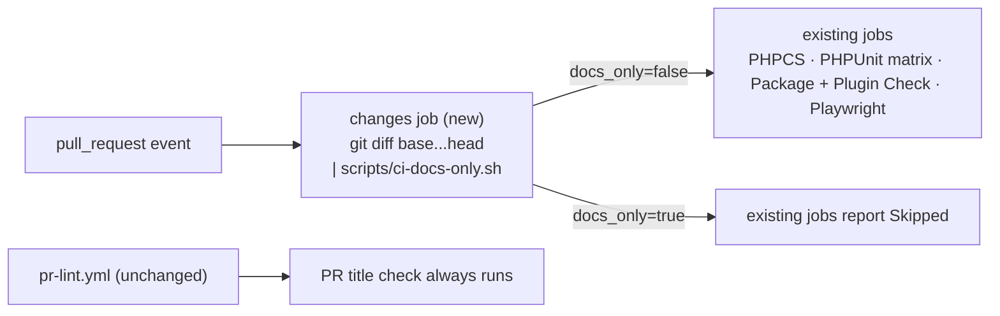

# Skip code CI on docs-only pull requests

## 📝 TLDR

A maintainer opening a pull request that touches only documentation (specs, `AGENTS.md`, `docs/`, agent skills) today waits for the full CI suite: PHPCS, a three-version PHPUnit matrix, the package build with Plugin Check, and a Playwright E2E run that boots WordPress and WooCommerce in wp-env (the slowest check, several minutes). Proposed: each code workflow starts with a small "detect docs-only change" job; when every changed file is on a docs allowlist, the code jobs report **Skipped** instead of running. The PR title lint still runs, and anything not on the allowlist — including `readme.txt`, which ships in the plugin and is read by Plugin Check — keeps the full suite.

## 📝 Problem Statement

- Observed: a docs-only PR (for example the spec PRs `om-auto-write-spec` opens, such as #43) runs `E2E / Playwright (wp-env + WooCommerce)`, `Code Quality / PHPCS`, `Code Quality / PHPUnit (PHP 8.3 / 8.4 / 8.5)` and `Code Quality / Package + Plugin Check` (`.github/workflows/code-quality.yml`, `.github/workflows/e2e.yml`). For the contributor docs, specs and agent skills, none of them reads the changed files: PHPCS scans PHP only, and `.distignore` keeps those files out of the package Plugin Check inspects.
- Not every Markdown file is inert, though: PHPUnit reads `CHANGELOG.md` (`tests/Unit/ReadmeChangelogSyncTest.php:178` checks that `readme.txt` lists every release in it) and the fixtures in `tests/Unit/fixtures/readme-sync/*.md`, and `scripts/build-package.sh` fails on a new root Markdown file that `.distignore` does not exclude. The classification must therefore be by path, not by extension.
- Cost: the agent pipeline (`om-auto-fix-pr`, `om-merge-buddy`, `om-approve-merge-pr`) waits for CI before a PR is merge-ready (`ci.maxWaitMinutes: 40` in `.ai/agentic.config.json`), so docs PRs — a large share of this repository's PRs — sit idle on E2E for no information gained, and spend runner minutes.
- Not evidence-backed: exact minutes saved per PR were not measured; the screenshot in the brief shows E2E still running after the other six checks finished.

## 📝 Proposed Solution

Add a classifier job at the top of `code-quality.yml` and `e2e.yml`. It lists the files the PR changes and pipes them through one repository script that answers "docs-only: true/false". Every existing job gains `needs: changes` and an `if:` that skips it when the answer is `true`.

**What counts as docs (allowlist, fail-closed):**

| Path pattern | Why it is safe to skip |
|---|---|
| Root `AGENTS.md`, `CLAUDE.md`, `SDLC.md`, `CODE_REVIEW.md`, `BACKWARD_COMPATIBILITY.md`, `README.md` (exact names) | Excluded from the package by name in `.distignore`; no test reads them. Exact names, so a *new* root Markdown file (which `build-package.sh` would reject as `stray_md`) still runs the package job. |
| `docs/**` | Contributor documentation, excluded by `.distignore`; no test reads it. |
| `.ai/**` except `.ai/qa/**` | Agent pipeline config, specs, analyses — never shipped, not read by CI. `.ai/qa/` is carved out because `playwright.config.ts:13` loads `.ai/qa/test-env.env` when present. |
| `.claude/**` | Agent skills — never shipped, not read by CI. |
| `.wordpress-org/**` | Directory listing assets; no PR check validates them (`wporg-assets.yml` syncs them after release). |

**Explicitly not docs** (full CI runs): `readme.txt` (ships in the package; Plugin Check validates its headers and `Stable tag`), `CHANGELOG.md` (read by PHPUnit, and synced into `readme.txt` at release by `scripts/sync-readme-changelog.php`), `tests/**` including its Markdown fixtures, `LICENSE` (ships; `build-package.sh` requires it), any other `*.md` (a new root file fails the package build, a nested one outside `docs/` may ship), `languages/**` (`.po`/`.mo` ship and drive translated messages that E2E checks), `.github/**` (a workflow change must prove itself — this also means the PR that introduces this feature, and any later edit of the classifier wiring, runs everything), `.distignore`, `scripts/**`, `composer.*`, `package*.json`. Any file the allowlist does not name means full CI.

**Alternatives considered:**

- *`paths-ignore` on the workflow trigger* — simplest, but a workflow that never starts reports no check at all. If `master` ever gets required status checks, those PRs would wait forever on a "Expected — waiting for status" check. A skipped *job* reports the conclusion `skipped`, which GitHub accepts for required checks. Lost.
- *`dorny/paths-filter` or `tj-actions/changed-files`* — popular, but a new third-party action in the CI supply chain (`tj-actions/changed-files` was compromised in March 2025 and leaked secrets from workflow logs). The job needs only `git diff --name-only`. Lost.
- *Suffix rule "only `.md`/`.txt`"* (the literal brief) — would skip Plugin Check on a `readme.txt` change (the one `.txt` file that ships and WordPress.org parses), PHPUnit on a `CHANGELOG.md` or Markdown-fixture change that the sync test reads, and the package job on a new root `.md` that breaks the build. Replaced by the path allowlist above.
- *Skip only E2E* — leaves the cheaper jobs; they still carry no information on a docs PR, and skipping all of them keeps one rule. Lost, but trivially recoverable by removing the `if:` from a job.

## 📝 Architecture

Takeaway: one new script plus one new job per workflow; the existing jobs only gain a `needs`/`if` pair, so turning the feature off is deleting two lines per job.

- **New:** `scripts/ci-docs-only.sh` — reads newline-separated paths on stdin, prints `true` only when the input is non-empty and every path matches the allowlist; otherwise `false`. Plain POSIX `case` globs, no dependencies, runnable locally (`git diff --name-only origin/master... | scripts/ci-docs-only.sh`). `scripts/` and `*.sh` are already in `.distignore`, so it never ships.
- **New job `changes`** ("Detect docs-only change") in `code-quality.yml` and `e2e.yml`: checkout with `fetch-depth: 0`, then diff `github.event.pull_request.base.sha...github.event.pull_request.head.sha` (merge-base diff, so commits that landed on `master` meanwhile do not count). Exposes `outputs.docs_only` and writes the decision plus the file list to the job summary, so a skip is explainable from the Actions page.
- **Changed jobs:** `phpcs`, `phpunit`, `package` (code-quality.yml) and `playwright` (e2e.yml) get `needs: changes` and `if: ${{ !cancelled() && needs.changes.outputs.docs_only != 'true' }}`. The `!cancelled()` plus `!= 'true'` form means a crashed or missing classifier runs the job (fail-closed).
- **Scope of the skip:** `pull_request` events only. `push` to `master`, the weekly `schedule` and `workflow_dispatch` always classify as `false`, so `master` stays fully verified and the weekly E2E compatibility run (`docs/CI-CD-SETUP.md`) is untouched.
- **Unchanged:** `pr-lint.yml`, `release.yml`, `wporg-*.yml`. No plugin runtime code, option, filter or order meta changes; nothing in `BACKWARD_COMPATIBILITY.md` is touched.
- **Pipeline consumers:** the tracker descriptor's **get-pr-checks** returns `state` per check; skipped jobs come back as `SKIPPED`. The `om-*` skills that gate on CI must treat that as non-failing — verified in Phase 2 against a real docs PR rather than assumed.

## 📝 Edge Cases & Failure Scenarios

- **Mixed PR (docs + one PHP file)** → `false`, full CI. Covered by a classifier test.
- **PR changes only `readme.txt`** → `false`; Package + Plugin Check runs, as it must.
- **PR edits `.github/workflows/*`** → `false`; workflow changes always run everything.
- **Empty diff** (e.g. a PR whose changes were already merged) → `false`; running CI on nothing is cheap and avoids a "green because skipped" surprise.
- **Renamed file** — `git diff --name-only` lists the new path only; a PHP file renamed into `docs/` would classify as docs. Use `--no-renames` so both old and new paths are listed and the PHP side forces `false`.
- **`git diff` fails** (shallow history, force-pushed base) → the step catches the error, writes `docs_only=false`, and notes it in the job summary; CI runs in full.
- **Classifier job itself fails or is cancelled** → dependent jobs still run (`!cancelled()` and an empty output is not `'true'`); a cancelled run stays cancelled.
- **Matrix job skipped** — GitHub shows a skipped matrix job under its unexpanded name, `PHPUnit (PHP ${{ matrix.php }})`. Cosmetic; acceptable because `master` has no required checks today (`gh api …/branches/master/protection` → 404 on 2026-10-13). If required checks are added later, require the expanded names only for code PRs or add a stable aggregate job — noted in `docs/CI-CD-SETUP.md`.
- **Added latency on code PRs** — every job now waits for the classifier (roughly 10–15 s for checkout and diff). Accepted against the minutes saved on docs PRs.

## 📝 Risks & Impact Review

- **Main risk: a file that matters is classified as docs**, merging untested code. Mitigations: an exact-path allowlist built from what CI and the package build actually read (unknown paths run CI), `--no-renames`, a table-driven test of the classifier, and `master` pushes always run the full suite, so a mistake is caught on the next push to `master` at the latest — before any release, since the Release workflow builds from the same commit and the weekly run also covers it.
- **Reversibility:** fully reversible — delete the `changes` job and the `needs`/`if` lines; no state, data or contract is involved.
- **Process contract:** `skip-qa` and `risk-low` already mark docs-only PRs (`SDLC.md`); this spec aligns CI with that classification and changes no label rule.
- **Decisions in play:** none of D01–D08 in `product-brief.md` concern CI; nothing superseded.

## Resolved assumptions (autonomous defaults)

| # | Question | Applied default | Why |
|---|---|---|---|
| Q1 | What counts as "docs"? A suffix rule (`.md`/`.txt`) or a path allowlist? | Path allowlist (table above); `readme.txt`, `CHANGELOG.md`, `tests/**`, `LICENSE`, `languages/**` and unlisted `*.md` are **not** docs. | Each of those is read by a check or ships; a suffix rule would skip exactly the checks that guard them. Fail-closed is the lower-blast-radius choice. |
| Q2 | Which checks are skipped? | E2E, PHPCS, PHPUnit matrix, Package + Plugin Check. PR title lint always runs. | None of the four reads an allowlisted file; the title drives semantic-release and must always be validated. |
| Q3 | Workflow-level `paths-ignore` or job-level skip? | Job-level skip behind a `changes` job. | A skipped job reports `skipped` (accepted by required checks); a never-started workflow leaves required checks pending forever. |
| Q4 | Skip on `push` to `master`, `schedule`, `workflow_dispatch` too? | No — pull requests only. | Keeps `master` and the weekly compatibility run fully verified; smallest change that removes the waiting. |
| Q5 | Use a third-party changed-files action? | No — a repository script over `git diff`. | No new supply-chain dependency; the logic is a dozen lines and testable locally. |
| Q6 | What happens when classification fails? | Run everything (`docs_only=false`). | A wasted CI run is cheap; a skipped check on code is not. |

All six are reversible by editing the script or the workflow `if:` lines; none needs human confirmation before merge.

## 📋 Phasing

- **Phase 1 — Classifier and wiring:** script, tests, both workflows wired, docs updated. Independently shippable; on its own PR it runs the full suite (it touches `.github/`).
- **Phase 2 — Verification on a real docs PR:** open a Markdown-only PR after Phase 1 merges and confirm the skip and the pipeline's handling of `SKIPPED`.

## 📋 Implementation Plan

### Phase 1 — Classifier and wiring

1. **Add `scripts/ci-docs-only.sh`** (executable, `#!/usr/bin/env bash`, `set -euo pipefail`): read paths from stdin, ignore blank lines, `case` each path against the allowlist, print `true`/`false`, exit 0 in both cases. Test: step 2.
2. **Add `tests/Unit/CiDocsOnlyClassifierTest.php`**: a data provider of path sets → expected answer, running the script through `proc_open` with the paths on stdin. Cases: only `AGENTS.md` → true; `.ai/specs/x.md` + `docs/CI-CD-SETUP.md` → true; `.claude/skills/a/SKILL.md` → true; `.wordpress-org/banner-772x250.png` → true; `readme.txt` → false; `CHANGELOG.md` → false; `tests/Unit/fixtures/readme-sync/CHANGELOG-1.5.0.md` → false; `NEW-NOTES.md` (unlisted root Markdown) → false; `src/notes.md` → false; `LICENSE` → false; `.ai/qa/test-env.env` → false; `languages/shift64-phone-validation-pl_PL.po` → false; `.github/workflows/e2e.yml` → false; `README.md` + `src/Validation/Normalizer.php` → false; empty input → false. Test: `composer test` green.
3. **Wire `code-quality.yml`**: add the `changes` job (checkout `fetch-depth: 0`; for `pull_request` run `git diff --no-renames --name-only "$BASE_SHA...$HEAD_SHA"` into the script, falling back to `false` on any error; for other events write `false`; append decision and file list to `$GITHUB_STEP_SUMMARY`). Add `needs: changes` and the `!cancelled() && … != 'true'` condition to `phpcs`, `phpunit`, `package`. Test: this PR's own CI runs all jobs (it changes `.github/`), and the `changes` job summary shows `docs_only=false` with the changed files.
4. **Wire `e2e.yml`** the same way for `playwright`. Test: as step 3.
5. **Add a wiring assertion to the classifier test**: read both workflow files as text and assert each gated job declares `needs: changes` and references `docs_only`, so a later refactor cannot silently drop the gate (same text-assertion approach as `MainFileWiringTest`). Test: `composer test`.
6. **Document** in `docs/CI-CD-SETUP.md` (new "Docs-only pull requests" section: the allowlist, why `readme.txt` is excluded, how to test locally, the matrix-name note for future required checks) and add the script to the CI row of the `AGENTS.md` task-routing table. Test: `composer phpcs` and `composer test` green (validation gate).

### Phase 2 — Verification on a real docs PR

7. **Open a Markdown-only PR** (e.g. a typo fix in `docs/`) and confirm: `changes` reports `docs_only=true`; PHPCS, PHPUnit, Package + Plugin Check and E2E show **Skipped**; PR title lint runs; the PR shows as mergeable.
8. **Confirm pipeline consumers**: run **get-pr-checks** on that PR and check that `om-merge-buddy` / `om-auto-fix-pr` classify `SKIPPED` checks as non-failing. If one treats `SKIPPED` as pending or failed, file a follow-up issue against the skills collection — changing those skills is out of this spec's scope.
