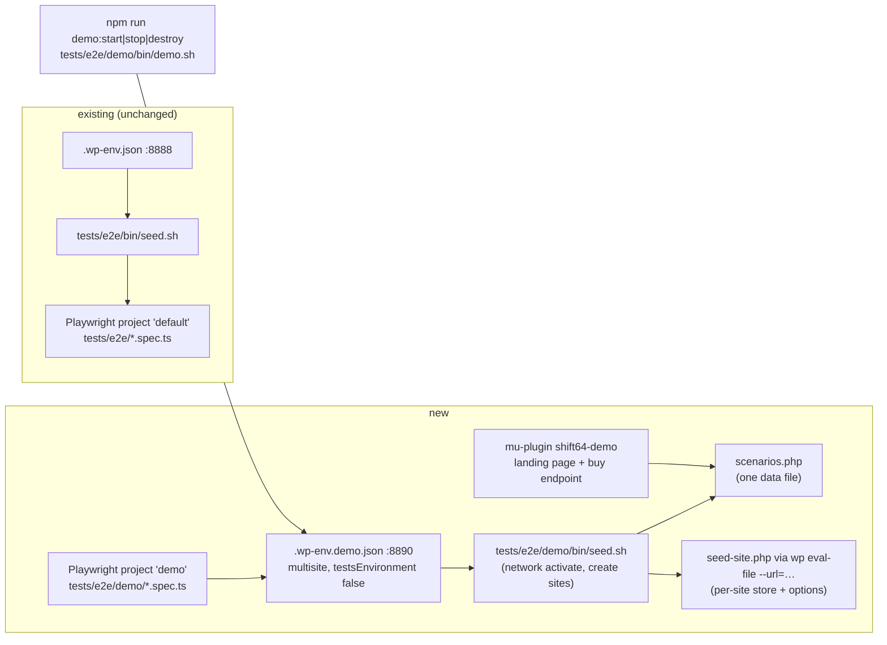
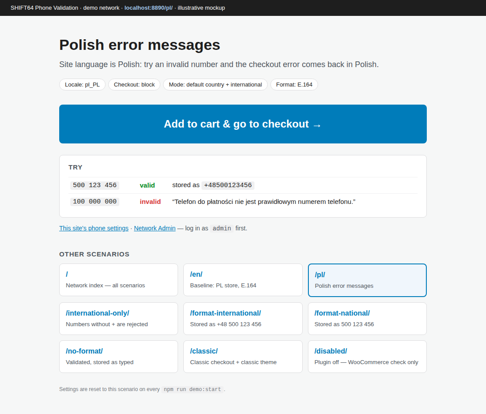
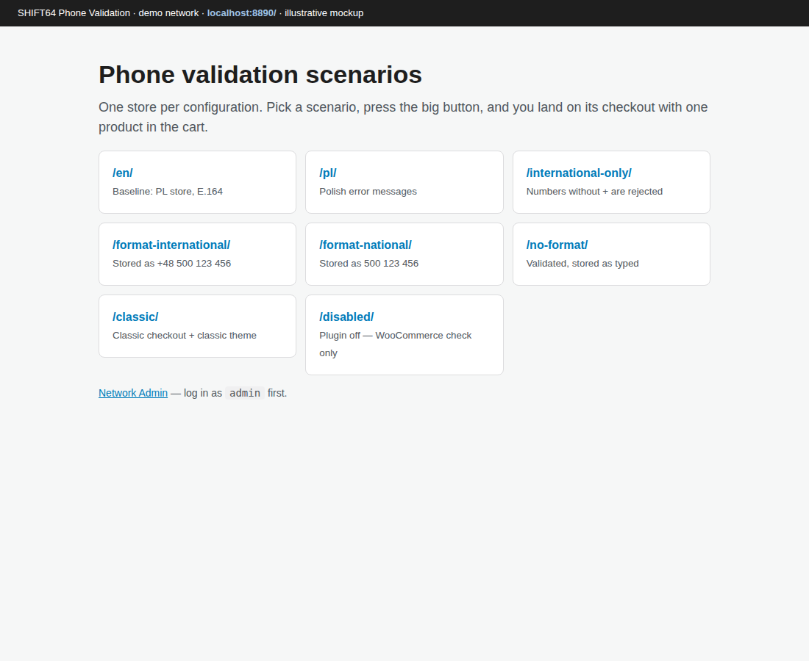

# Scenario demo multisite

Brief: `.ai/specs/briefs/2026-10-15-scenario-demo-multisite.md`

## 📝 TLDR

Today the maintainer has no quick way to show the plugin in several configurations side by side. To see Polish messages, another output format or the classic checkout, they have to change the one wp-env site by hand, and multisite has no tests at all. **Proposed:** a second, opt-in wp-env profile, `npm run demo:start`. It boots a subdirectory multisite on `localhost:8890` with WooCommerce and the plugin network-activated, and one subsite per scenario (`/pl/`, `/format-national/`, `/classic/` …). Each subsite opens on a page that names the scenario, shows a big **Add to cart → checkout** button and links to every other scenario. A small Playwright smoke project runs against it in CI and covers the network-activated path. The default single-site environment (`.wp-env.json`, port 8888) and its suite stay unchanged.

## 📝 Problem Statement

- **No side-by-side view.** `tests/e2e/bin/seed.sh` configures one store with one language, one theme and one set of plugin options. Showing a client the Polish messages, then the national output format, means switching the site language or settings in wp-admin between clicks. The e2e specs that need such a state flip it and flip it back: `block-checkout-polish-messages`, `classic-checkout-classic-theme-highlight` and both `admin-*` specs. That is why `playwright.config.ts` pins `workers: 1`.
- **Multisite is untested.** Both multisite defects so far only appeared with the plugin network-activated: dependency notices missing on Network Admin (#38, fixed in #49), and the `load_plugin_textdomain()` call the main plugin file needs because WordPress 7.1 registers `languages/` itself only for plugins activated per site (`AGENTS.md`, "Error messages and i18n"). No automated check exercises either path today.
- **Evidence level:** the need for a demo is the maintainer's request (brief). The demo has no measured users. The multisite gap is evidenced by #38 and the textdomain workaround.

## Resolved assumptions (autonomous defaults)

The brief's Resolved-unknowns table settled the direction: separate profile, network-activated, subdirectory, one data file, feasibility spike, single-site suite unchanged. These defaults cover what it left open:

| # | Question | Applied default | Why |
|---|---|---|---|
| Q1 | The brief's "just-local" scenario: the plugin has no "local numbers only" mode. Its validation modes are `default_and_international` and `international_only` (`src/Admin/Settings.php`). | Ship real modes only. `international-only` is a scenario; "just-local" is dropped. A local-only mode would be a product feature with its own spec. | A demo that shows a mode the plugin lacks would mislead. Adding a validation mode is out of scope for a dev-tooling spec. |
| Q2 | Should the landing page be a seeded page with a shortcode, or rendered by an mu-plugin? | A demo-only mu-plugin renders the front page of each demo site through `template_include` (no page content stored). The button goes to a demo endpoint that empties the cart, adds the product and redirects to checkout. | Nothing to keep in sync in the database, and re-seeding is idempotent. With an empty-then-add endpoint the quantity is always 1, however many times the button is clicked. |
| Q3 | Should the CI smoke run on every PR or only weekly? | On every non-docs PR, as its own job in `e2e.yml`, in parallel with the existing `playwright` job and behind the same docs-only gate. | Network activation is a runtime path that a plugin change can break. A parallel job adds runner minutes, not wall time. Moving it to `schedule` only is a one-line change. |
| Q4 | Agent hosts run as root, and WP-CLI in wp-env refuses root (memory and PR #56). | `npm run demo:*` calls one shell entrypoint that reuses the root → `TEST_ENV_RUN_AS` (default `wpenv`) handoff and the php8.3 guard from `.ai/scripts/test-env-up.sh`. | The demo has to start on the same hosts the QA env starts on, without anyone working around the host by hand. |
| Q5 | Which scenarios? | The 8 in the table under **Data Model**. | Each shows a distinct, already-shipped behavior. A ninth is one entry in the data file. |

## 📝 Proposed Solution

A separate wp-env config started with `--config` (wp-env 11 runs several configs from one folder, each with its own containers and port). Its `afterStart` hook runs a demo seed script, which reads one scenario file and builds the network.

**Feasibility spike, done while writing this spec (2026-10-15, wp-env 11.15, WordPress trunk, WooCommerce 11.2.1, PHP 8.3)** with a throwaway `"multisite": true` config on port 8890:

| Check | Result |
|---|---|
| Network type on a non-80 port | `is_multisite()` true, `SUBDOMAIN_INSTALL` false, `DOMAIN_CURRENT_SITE` = `localhost:8890`. No workaround needed. |
| Plugin activation | wp-env activates the listed plugins **on the main site only**. `wp plugin activate woocommerce.latest-stable <plugin-dir> --network` is needed; after it, both show `active-network`. |
| WooCommerce on a new subsite | Right after `wp site create --slug=pl`, `wp --url=localhost:8890/pl/ …` finds the shop, cart, checkout and my-account pages. COD, a flat-rate method on zone 0 and the product were created through `wc` CLI commands. The first boot logs transient "table `wp_2_wc_webhooks` doesn't exist" database errors while WooCommerce installs its tables for the new site. |
| Routing under the subdirectory | `/pl/`, `/pl/product/e2e-test-product/`, `/pl/wp-json/wc/store/v1/cart` → 200. `wp rewrite structure` warns that it cannot write `.htaccess` for multisite; harmless, because wp-env's own `.htaccess` already routes subdirectories. |
| Block checkout on `/pl/` (Store API) | Site language `pl_PL`: phone `100 000 000` → `invalid_billing_phone`, "Telefon do płatności nie jest prawidłowym numerem telefonu." (the plugin's Polish message, network-activated). Phone `500 123 456` → order `processing`, billing phone stored as `+48500123456`. |
| Admin | Logging in on the main site authorises `/pl/wp-admin/` (200). `/wp-admin/network/plugins.php` shows no SHIFT64 notice in a healthy env. |
| Side effects | Without `"testsEnvironment": false`, wp-env 11 also starts a tests site on **8889**. The demo config must set it. |

**Alternatives** (and why they lost) are in the brief: making the default env multisite, a Playground / WordPress.org Live Preview blueprint (parked), and building nothing.

## 📝 Architecture

Takeaway: everything new lives under `tests/e2e/demo/`, plus one hidden config file at the root. The existing env, seed and specs gain only an `testIgnore` for the new directory. No plugin runtime code changes.

New files:

- **`.wp-env.demo.json`.** Same `core`, `phpVersion` and `plugins` as `.wp-env.json`, plus `"multisite": true`, `"port": 8890`, `"testsEnvironment": false`, the debug `config`, `mappings: { "wp-content/mu-plugins": "./tests/e2e/demo/mu-plugins" }` and `lifecycleScripts.afterStart: "sh tests/e2e/demo/bin/seed.sh"`. It does not map `tests/e2e/mu-plugins`: the reworded-messages fixture is test-only.
- **`tests/e2e/demo/mu-plugins/shift64-demo/scenarios.php`.** Returns the scenario array (see Data Model). It is the single source: both the seed and the landing page `require` it.
- **`tests/e2e/demo/mu-plugins/shift64-demo.php`.** The mu-plugin loader:
  - a `template_include` filter that, on `is_front_page()` of a site whose path matches a scenario slug (or of the main site), renders `shift64-demo/landing.php`;
  - a `template_redirect` handler for `?shift64_demo=buy` that empties the cart, adds the seeded product and redirects to the scenario's checkout URL (`wc_get_checkout_url()`, which follows each site's `woocommerce_checkout_page_id`).
  
  It does nothing on sites that are not in the scenario file.
- **`tests/e2e/demo/bin/seed.sh`.** POSIX sh, idempotent, like `tests/e2e/bin/seed.sh`, and every `wp-env run` passes `--config=.wp-env.demo.json`. Steps:
  1. Check that `vendor/autoload.php` exists.
  2. Install core `pl_PL` (and the WooCommerce `pl_PL` pack, warn-only).
  3. Install `twentytwentyone` and enable it for the network (`wp theme enable twentytwentyone --network`). On multisite, a theme that is not network-enabled cannot be activated on a subsite.
  4. Network-activate WooCommerce and the plugin. The plugin's directory is the checkout folder name, so resolve it from the repository basename, never hard-code `shift64-phone-validation`.
  5. For each slug, `wp site create` when missing.
  6. Run `wp --url=localhost:<port>/<slug>/ eval-file …/shift64-demo/seed-site.php <slug>` for each scenario, and once for the main site as `index`, with `--url=localhost:<port>/` (the network root, not a `/index/` subsite).
- **`tests/e2e/demo/mu-plugins/shift64-demo/seed-site.php`.** Runs inside WordPress for one site. It applies the store baseline that `tests/e2e/bin/seed.sh` sets today: permalinks, coming-soon off, store address PL/PLN, guest checkout, COD, flat rate on zone 0, product `e2e-test-product`, a `classic-checkout` page, and `woocommerce_checkout_page_id` pointed at the block `checkout` page. Then it applies the scenario's language, theme, checkout page choice and `shift64_phone_validation_*` options. It uses WooCommerce PHP APIs (`WC_Payment_Gateways`, `WC_Shipping_Zone`, `WC_Product_Simple`) rather than one `wp-env run` per setting, so seeding 9 sites stays in one container call each.
- **`tests/e2e/demo/bin/demo.sh start|stop|destroy`.** Contains the root → `TEST_ENV_RUN_AS` handoff and the php8.3 guard copied from `.ai/scripts/test-env-up.sh`, then runs `npx wp-env <cmd> --config=.wp-env.demo.json`. On `start` it runs `composer install` first, as `env:start` does. It reads its own `WP_DEMO_PORT` (default 8890) and maps it to `WP_ENV_PORT` only for its own `wp-env` call. An exported `WP_ENV_PORT` is not passed through, because the default project's `baseURL` and `test-env-up.sh` read that variable too. It prints the network URL when done.
- **`package.json`.** Adds `demo:start`, `demo:stop` and `demo:destroy` (calling `demo.sh`), and `test:e2e:demo` (`playwright test --project=demo`).
- **`playwright.config.ts`.** Two `projects`:
  - `default`: today's settings and `baseURL`, `testIgnore: /demo\//`;
  - `demo`: `testDir: tests/e2e/demo`, `baseURL` from `WP_DEMO_BASE_URL`, or else `http://localhost:${WP_DEMO_PORT ?? 8890}`.
  
  Playwright runs every project by default, so the `demo` project is added to `projects` only when `WP_DEMO=1` is set. `npx playwright test` without `--project` therefore keeps running only `default`, and CI's existing job and the `.ai/scripts` consumers are untouched. The demo specs get a small `tests/e2e/demo/site.ts` helper, `sitePath(slug, path)` → `/${slug}/${path}`, and use the root `baseURL`. The shared `tests/e2e/helpers/*.ts` stay unchanged: they use absolute paths (`/checkout/`, `/wp-login.php`), and one smoke spec visits several subsites and the network admin, so no single subsite `baseURL` fits.
- **`.github/workflows/e2e.yml`.** A new job `playwright-multisite` ("Playwright (multisite demo)") with the same `needs: changes` / `if:` gate and the same setup steps as `playwright`. It starts the env with `npx wp-env start --config=.wp-env.demo.json`, runs `WP_DEMO=1 npx playwright test --project=demo` with `TEST_ADMIN_USER` / `TEST_ADMIN_PASSWORD` exported on that step (as the existing job does on its test step), uploads the report as `playwright-report-multisite`, and prints the debug log on failure.
- **Docs.** A "Demo network" section in `README.md` (Development) and `docs/CI-CD-SETUP.md` (the new job), plus one line in the `AGENTS.md` Tests routing row pointing at `tests/e2e/demo/`.

Unchanged: `.wp-env.json`, `tests/e2e/bin/seed.sh`, every existing spec and helper, `.ai/scripts/test-env-{up,down}.sh` and the `om-prepare-test-env` descriptor. Neither `.distignore` (its `.*` and `/tests` already exclude every new path; the package job proves it) nor `scripts/ci-docs-only.sh` (`tests/**` and root hidden files already run full CI) needs a change.

## 📝 Data Model

The data model is the scenario file only: no options, tables or order meta of the plugin are touched. Each entry: `slug`, `title`, `description` (one sentence: what to try), `locale`, `theme` (`null` = default block theme), `checkout` (`block` | `classic`), `options` (a map of `shift64_phone_validation_*` suffix → value; unlisted options keep the plugin defaults), and `try` (example inputs shown on the landing page: one valid and one invalid number, with the expected stored value).

| Slug | Shows | Locale | Theme / checkout | Options |
|---|---|---|---|---|
| `en` | Baseline: PL store, E.164 | en_US | block / block | defaults (`enabled` yes, `default_country` PL, `default_and_international`, `E164`, `format_on_save` yes) |
| `pl` | Polish error messages | pl_PL | block / block | defaults |
| `international-only` | Numbers without `+` are rejected | en_US | block / block | `validation_mode` = `international_only` |
| `format-international` | Stored as `+48 500 123 456` | en_US | block / block | `output_format` = `INTERNATIONAL` |
| `format-national` | Stored as `500 123 456` | en_US | block / block | `output_format` = `NATIONAL` |
| `no-format` | Validated, stored as typed | en_US | block / block | `format_on_save` = `no` |
| `classic` | Classic checkout, classic notices and highlight | en_US | `twentytwentyone` / classic (`woocommerce_checkout_page_id` → `classic-checkout`) | defaults |
| `disabled` | Plugin off: WooCommerce's loose check only | en_US | block / block | `enabled` = `no` |

The main site (`/`) is the **index**. It is seeded like `en` so it is a working store, but its front page lists every scenario as a card instead of a buy button.

## 📝 UI/UX

Two templates, both plain server-rendered HTML with inline CSS. They are demo-only, so no theme integration and no JS. Every visible string is English and hard-coded: they are dev fixtures outside the plugin's text domain, so PHPCS does not scan `tests/`.

- **Scenario landing page** (front page of each scenario subsite):
  - The scenario title and a one-line description.
  - A settings chip row: locale, checkout type, validation mode, output format.
  - The primary button **Add to cart & go to checkout** (`?shift64_demo=buy`).
  - The "Try" box: a valid and an invalid example number and the expected stored value.
  - A "Network Admin" and "This site's settings" link (to the plugin's WooCommerce tab). The links only work when logged in, and the page says so.
  - Below, an **Other scenarios** grid linking to every sibling plus the index, with the current one marked.
- **Index** (network root): a heading, one sentence, and one card per scenario (title, description, link).
- **States:**
  - WooCommerce inactive on the site (seed failed): the page renders a plain "Store not seeded — run `npm run demo:start`" notice instead of a broken button.
  - Unknown site path: the theme's normal front page.
- **Accessibility:** the button is a real link (`<a>`) with a visible focus ring, and its text says where it goes. The scenario grid is a `<nav aria-label="Scenarios">` list, and the current scenario has `aria-current="page"`.

Prototype: `.ai/specs/assets/scenario-demo-multisite/mockup-01-scenario-landing.html`, `.ai/specs/assets/scenario-demo-multisite/mockup-02-network-index.html`

## 📝 Edge Cases & Failure Scenarios

- **Port 8890 taken.** `wp-env start` fails with its own port error, and `demo.sh` suggests `WP_DEMO_PORT`. The seed and Playwright read the port from `WP_DEMO_PORT`, never hard-coded. The network stores its domain (`DOMAIN_CURRENT_SITE` = `localhost:8890`, seen in the spike) at install time, so changing the port of an existing demo needs `npm run demo:destroy` first. `demo.sh` warns when the requested port differs from the stored domain.
- **Default env running at the same time.** The two are separate configs and containers on 8888 and 8890, as verified in the spike while another env held 8888.
- **Re-running `demo:start`.** The seed is idempotent: sites, products, pages and zone methods are created only when missing. Options and theme are re-applied every time, so hand-edited demo settings are reset. This is intended: the demo always starts from the documented state, and the landing page says so.
- **WooCommerce first-boot database errors on a new subsite** (spike) are transient. The seed must not treat the debug log as a failure signal, and the smoke spec must not assert an empty debug log.
- **`pl_PL` pack download fails** (offline). Core `pl_PL` failing fails the seed, because the `pl` scenario would lie. The WooCommerce pack failing only warns, as in `tests/e2e/bin/seed.sh`.
- **Plugin directory name.** wp-env names the plugin after the checkout folder (`808b3739-…` in a cezar worktree, as seen in the spike). The seed resolves it and never assumes `shift64-phone-validation`.
- **Root on agent hosts.** `demo.sh` hands over to `TEST_ENV_RUN_AS`. If that user is missing, it exits with the same message as `test-env-up.sh`.
- **The buy endpoint without WooCommerce, or the product missing.** It redirects to the landing page with `?shift64_demo=missing` and shows the "not seeded" notice. No fatal error.
- **The CI multisite job flakes.** It is a separate job, so it fails visibly without masking the single-site job. It uses the same `retries: 1` in CI and the `placeOrder()` helper hardened in #56.

## 📝 Risks & Impact Review

- **No contract surface changes.** No filter, option, order meta or package content changes (`BACKWARD_COMPATIBILITY.md`). All new files are dev-only and excluded from the package by existing `.distignore` rules; the `package` job in `code-quality.yml` proves the ZIP is unchanged.
- **CI cost.** One more wp-env boot per non-docs PR, about 2–4 runner minutes. Wall time is unchanged because the jobs run in parallel. Reversible by deleting the job, or moving it to `schedule` only.
- **Maintenance.** The store baseline now exists twice: shell in `tests/e2e/bin/seed.sh`, PHP in `seed-site.php`. Accepted to keep the default env untouched (brief non-goal). The follow-up that migrates the default suite to scenario sites would remove the duplication. Until then, a change to the default baseline needs the same edit in `seed-site.php`, and a comment in both files says so.
- **Product decisions in play:** none. The product brief's decisions concern the plugin and its distribution (D05 WordPress.org-only updates, D07 the textdomain call), and the demo touches neither. It exercises the D07 code path, which strengthens it.

## 📋 Phasing

1. **Demo network** (its own PR). Config, seed, scenario file, landing mu-plugin and `npm run demo:*`. Shippable on its own: the maintainer can demo.
2. **Multisite smoke in CI** (its own PR, after phase 1). Playwright `demo` project, smoke spec, `e2e.yml` job and docs. The smoke spec does not depend on the landing page's look: it goes straight to `/pl/product/…` and `/pl/checkout/`. A cosmetic change to the demo page therefore cannot turn CI red; only one test covers the buy endpoint.

## 📋 Implementation Plan

**Phase 1: demo network**

1. Add `.wp-env.demo.json` and `tests/e2e/demo/bin/demo.sh` (root handoff, php guard, `start|stop|destroy`), and the `demo:*` scripts in `package.json`. The seed hook is a stub that only network-activates both plugins. *Test:* `npm run demo:start` → `wp-env run cli --config=.wp-env.demo.json wp plugin list` shows both plugins `active-network`, and `curl localhost:8890/` → 200. The default env on 8888 still starts.
2. Add `scenarios.php` and `seed-site.php`, and finish `tests/e2e/demo/bin/seed.sh`: languages, theme, site creation, a per-site `eval-file`. *Test:* run it twice; the second run creates nothing new (`wp site list` and the product count are stable). On `/pl/`, `get_locale()` is `pl_PL`; on `/classic/`, `woocommerce_checkout_page_id` is the `classic-checkout` page.
3. Add the `shift64-demo.php` mu-plugin and `landing.php`: front-page template for scenarios and the index, and the `?shift64_demo=buy` endpoint. *Test:* in a browser, from `/pl/` the button leads to `/pl/checkout/` with exactly one item, and clicking it twice still gives quantity 1. The index lists 8 cards. A non-scenario page renders normally.
4. Docs: the README "Demo network" section, with the commands, the URL, the scenario table generated by hand from `scenarios.php`, and the "re-seeding resets settings" note. *Test:* follow the README from a clean clone.

**Phase 2: multisite smoke in CI**

5. Add the Playwright `projects` split. `default` keeps today's settings and has `testIgnore: /demo\//`. `demo` is added only under `WP_DEMO=1`, and `tests/e2e/demo/site.ts` provides `sitePath()`. *Test:* `npx playwright test --list` shows the same test count as before, and `WP_DEMO=1 npx playwright test --project=demo --pass-with-no-tests` exits 0.
6. Add `tests/e2e/demo/multisite-smoke.spec.ts`, navigating with `sitePath()`. On `/pl/`, add the product from its product page; on `/pl/checkout/`, `100 000 000` shows the Polish billing-phone message. On `/en/`, a valid `500 123 456` places an order. Logged in as admin, `/wp-admin/network/plugins.php` lists the plugin as Network Active, and no `.notice` mentions SHIFT64. One test: the `/pl/` landing button leads to `/pl/checkout/` with one item. Field filling reuses the shared helpers' selector logic only where it takes no absolute path, and is otherwise copied into `tests/e2e/demo/` rather than changing the shared helpers. *Test:* the spec passes locally, and fails when the plugin is network-deactivated (manually verified once).
7. Add the `playwright-multisite` job to `e2e.yml`, and document it in `docs/CI-CD-SETUP.md` and the `AGENTS.md` Tests row. *Test:* the job is green on the implementation PR and skipped on a docs-only PR.

Validation gate for every step: `composer phpcs`, `composer phpstan` and `composer test` stay green (no runtime PHP changes), and the existing `playwright` job stays green and unchanged.
